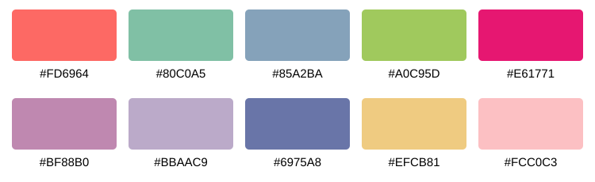

# nature绘图skills · Nature Compact Figures

用于科研图的可复用 Codex 技能：紧凑布局、图小字大、统一 Arial 和固定十色首选配色。

## 风格

- 最终正文优先 **7 pt**，密集图 **6 pt**，任何有意义文字不低于 **5 pt**。
- 常用单栏89 mm、双栏180–183 mm；减少留白和重复标签，保持可读性。
- 默认输出矢量 PDF、保留文字的 SVG 与600 dpi PNG。
- 适用统计图、单细胞图、热图、气泡图、网络图及多面板拼图。
- 尊重已有定稿模板；不改变原始数据、统计或筛选条件。
- 细化线宽、散点、透明度、图例间距及面板对齐；以有效信息优先，避免过度压缩。
- 最终物理尺寸与放大预览双重检查，保证浅色、稀疏点和误差线仍可辨识。



## 安装

将本仓库完整克隆至个人技能目录。以下命令适用于默认目录；自定义目录时相应调整：

```bash
git clone https://github.com/GZUCM-Liyu-Lin/nature-compact-figures.git ~/.codex/skills/nature-compact-figures
```

如果同名目录已存在，请先检查现有内容，不要直接覆盖。

## 使用

```text
使用 $nature-compact-figures 绘图，按Nature/NC紧凑风格，主体7pt、最低5pt，使用首选十色，输出可编辑PDF/SVG。
```

Matplotlib 可独立加载附带样式（需要安装 matplotlib，并具备Arial字体）：

```python
from pathlib import Path
import matplotlib.pyplot as plt

skill_dir = Path.home() / '.codex' / 'skills' / 'nature-compact-figures'
plt.style.use(skill_dir / 'assets' / 'nature_compact.mplstyle')
```

## 文件

| 文件 | 用途 |
|---|---|
| [SKILL.md](SKILL.md) | 完整绘图规则与交付检查 |
| [agents/openai.yaml](agents/openai.yaml) | 技能显示名称及自动调用配置 |
| [assets/palette.json](assets/palette.json) | 十色HEX与RGB |
| [assets/palette.svg](assets/palette.svg) | 矢量色卡 |
| [assets/nature_compact.mplstyle](assets/nature_compact.mplstyle) | Matplotlib样式 |

此为用户定制的Nature/NC风格，不隶属于Nature，也不代表期刊认证。DEMO、SIMULATED、ESTIMATED数据属性须保留在文件名、数据表和元数据中。实际投稿要求以目标期刊最新指南为准。
